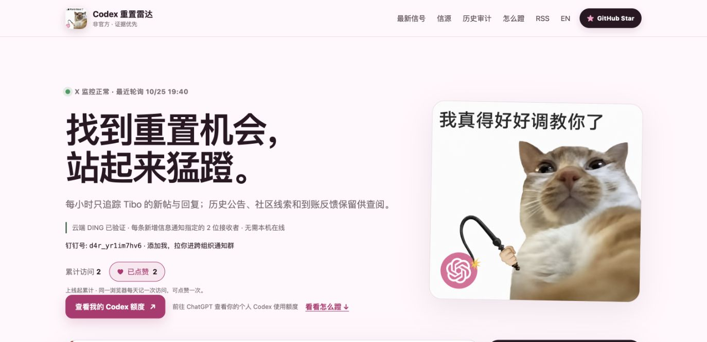

<p align="center"></p>

<h1 align="center">Codex 重置雷达</h1>

<p align="center">有重置信号时收到提醒，把剩余额度花在有产物的任务上。</p>

<p align="center">
  <a href="https://codex-reset-watcher.weican16hit.workers.dev/">打开雷达</a> ·
  <a href="https://codex-reset-watcher.weican16hit.workers.dev/en/">English</a> ·
  <a href="https://farmcan.github.io/codex-reset-watcher/">备用站</a> ·
  <a href="https://codex-reset-watcher.weican16hit.workers.dev/feed.xml">RSS</a>
</p>

<p align="center">
  <a href="https://github.com/farmcan/codex-reset-watcher/actions/workflows/ci.yml"></a>
  · <a href="LICENSE">MIT 开源</a> · 非官方项目
</p>

追踪 Codex 的公开额度重置信号：**什么时候说的、谁说的、是预告还是已完成，点开都有原帖。**
当前每 20 分钟检查 Tibo 的新帖与回复，Cloudflare 在云端持续运行，无需维护者本机在线。

<details>
<summary>查看主页截图</summary>



</details>

## 直接使用

1. **看信号**：[打开雷达](https://codex-reset-watcher.weican16hit.workers.dev/)，查看当前判断和每轮事件的证据。
2. **收通知**：钉钉添加 `d4r_yr1im7hv6`，联系维护者加入跨组织通知群。应用内 DING 需要接收者与发送账号为好友或同事；接收范围以页面实际状态为准。
3. **安排任务**：[看看怎么蹬](https://codex-reset-watcher.weican16hit.workers.dev/#pedal)，从维护、调研、开源贡献和悬赏中选一个能验收的任务。
4. **核对额度**：[个人 Codex Usage](https://chatgpt.com/codex/settings/usage) 才能确认你的实际剩余额度和到账情况。

## 现在能做什么

| 能力 | 实际行为 |
| --- | --- |
| 分清消息 | 未来全量重置、已经重置、可储存重置卡、弱暗示分别标注 |
| 看清依据 | 保留原帖、时间、内容分类和事件时间轴；中英文页面 |
| 云端 DING | 新增网页可见信号进入持久队列，向配置的接收者发送真正应用内 DING；逐人回执去重，群消息 @所有人，登录自动刷新 |
| 看重置时间 | 预告、精确执行时刻、确认公告分开显示；原文没给具体时刻就明确标为未公布 |
| 发现异常 | 抓取、复核和通知分别显示状态；失败或未知不当作“没有新消息” |
| 用好剩余额度 | 15 个 Token maxxing 入口，附任务模板、产物、时间上限和来源 |
| 访问与点赞 | 中英文共用累计数，同一浏览器每天一次访问、一次点赞；从功能上线开始记录 |

首页每分钟刷新。备用站约每 10 分钟同步公开快照，页面会标出快照状态；访问量与点赞请使用实时站。

## 下一步：重置前自动开工

目标是：**可信的重置前信号 → 自己的 Dot → Codex 执行预先准备的任务目录。**

个人账号已实测：Cloudflare 事件自动触发 Dot，真实委派 Codex 并产出核验通过的文件。
自然 Reset 自动执行和多用户接入尚未开放；长期订阅管理仍需完善。
多用户方案将让每个人授权自己的 Dot，各自配置任务、预算与停止条件，使用各自的 Codex 额度。

[接入调研、现成方案与验收条件 →](docs/research-reset-task-triggers.md)

## 先分清三件事

- **预告不等于到账**；只有明确的一手未来全量重置，才提示提前安排已有任务。
- **Banked reset 不等于自动清空额度**，它是可储存或手动使用的权益。
- **公开信号不等于个人额度**；本站不读取你的 Codex 登录，也不预测私人 5 小时或周窗口。

[12 轮历史审计](docs/historical-audit.md)用于回看证据，不能当作未来预测准确率。[信源判断方法](docs/credibility-methodology.md) · [怎么蹬的筛选依据](docs/research-pedaling-workflows.md)

## 本地运行与自托管

```sh
npm install
npm run db:migrate:local
cp .dev.vars.example .dev.vars
npm run dev
```

需要 Node.js 22+；真实抓取需要自己的 X API 凭据。完整检查运行 `npm run check`。

部署、Cloudflare Secrets、通知接收者、邮件及 API 说明统一放在 [自托管与运维](docs/self-hosting.md)。
[架构](docs/architecture.md) · [贡献](CONTRIBUTING.md) · [安全反馈](SECURITY.md) · [许可证](LICENSE)

中文网页与钉钉使用中文小猫图，英文网页使用英文小猫图。项目与 OpenAI、X 或被追踪账号无官方隶属关系。
