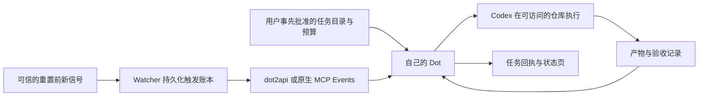

# Reset 信号 → Dot → Codex：自动启动任务调研

核验：2026-10-25，Asia/Shanghai。初稿只调研；随后用户授权本人账号实测，结果见文末。自然 Reset 自动执行和多用户接入仍未启用。

**这条链路可行。WatchDot 已复用的 `dot2api` 就是现成接入方案。用户提供的应是自己的任务网关与受限凭据，普通 Dot 聊天链接不能直接当 webhook。** 面向普通用户，也可以让 Watcher 自己提供 MCP Events，用户连接插件并授权订阅，无需自己搭网关。

## 已确认与当前缺口

| 问题 | 核验结果 |
| --- | --- |
| 外部事件能自动触发 Dot 吗？ | 官方 MCP Events 明确支持 Dot，以及云端 Work 会话；用户先指定订阅对象和收到事件后做什么。不是普通 MCP tools 连接后就自动运行。[官方协议](https://developers.openai.com/plugins/build/mcp-events) |
| Dot 能启动 Codex 吗？ | 可创建本地 Codex 任务、继续已有本地任务，也可使用预先配置的 Codex 云环境。访问本机须电脑在线且 ChatGPT App 打开。[任务文档](https://learn.chatgpt.com/docs/dots/tasks-and-memory)、[本机连接](https://learn.chatgpt.com/docs/dots/getting-started#connect-your-computer) |
| WatchDot import 的是什么？ | MIT 的 [Pluviobyte/dot2api](https://github.com/Pluviobyte/dot2api)，固定 commit `66a761505ff73c5dca730260efcaeb5697db81ad`。当前上游 main 仍是此 commit，未 archived；本机源码和上游版本相符。任务库、幂等键、租约、签名回调和重试均已有实现。 |
| 曾经真跑过吗？ | WatchDot 的 2026-10-09 脱敏验收记录显示：公网提交 → Events → 真实 Dot → Codex → 本机创建文件 → 客户端读回同一任务结果，含实际文件哈希。它是既有历史证据，本轮没有重新执行。 |
| 旧 WatchDot 入口现在能直接用吗？ | 不能。本轮只读检查：本机 8788 无监听；公网 `/readyz` 返回 404；本地数据库 1 个订阅已过期，4 个凭据均已过期。没有恢复进程或重新授权。 |
| 能消耗现有 Codex 订阅额度吗？ | Dot 委派的 Work/Codex 任务按相应产品额度计量；Dot 对话本身不等于消耗 Codex 额度。[Dot 额度说明](https://learn.chatgpt.com/docs/dots#access) 本机 Codex CLI 当前已用 ChatGPT 登录；这种登录提供订阅访问。API key 方式走 API 计费，不能算用掉订阅剩余额度。[认证文档](https://developers.openai.com/codex/auth) |

本机 WatchDot 工作区核验版本：`535f45843158ad79655e820c87bda81282b54483`。
阅读了 `docs/mcp-events-flow.md`、`docs/live-acceptance.md`、`docs/evidence/event-codex.json`、`THIRD_PARTY.md`，以及固定上游的 `app.py`、`models.py`、`events.py`、`protocol.py` 和 API 文档。未读取或公开原始 token、回调 URL、任务正文或私人结果。

## 三条路线

| 路线 | 具体入口 | 运行条件与判断 |
| --- | --- | --- |
| 个人最小验证：复用 dot2api | Watcher `POST /v1/tasks` → 已连接插件的 `task.available` → Dot → Codex | 改动最少，可复用 WatchDot。需恢复网关、独立 caller 权限、有效 Dot 订阅和明确常驻指令。当前网关数据库仍在 Mac；Cloudflare 中继没有消除 Mac 在线依赖。 |
| 面向多用户：Watcher 原生 MCP Events | 用户连接 Watcher 插件，要求自己的 Dot 订阅 `reset.prewarning` → Watcher 向平台提供的签名回调发送事件 | 推荐产品方向。沿用现有 Workers + D1，免每人自搭 Python 网关。需新增 MCP discovery/tools/events、按用户隔离的持久订阅、回调校验与续订、事件出站账本。现有 Watcher 尚未实现这些接口。 |
| 直接启动 Codex | 本机常驻接收器/拉取器 → `codex exec` 或 Codex SDK | 用户只要用订阅做代码任务时可省去 Dot。任务执行器须在能访问仓库且已登录的电脑/服务器上，Cloudflare Worker 本身不能调用用户本机 CLI。[非交互执行](https://developers.openai.com/codex/noninteractive)、[SDK](https://learn.chatgpt.com/docs/codex-sdk) |

`codex app-server` 也有 `thread/start`、`turn/start` 等正式文档化方法，但 WebSocket transport 当前标为实验且不支持生产负载，不把它裸露到公网当用户接收地址。[App Server](https://developers.openai.com/codex/app-server)

本机 `codex-cli 0.163.0` 的 help 确认存在 `exec`、`queue`、`app-server`；只执行了版本、help 和登录状态查询，没有启动模型任务。`codex queue` 可为已有会话排消息，但本轮未验证其在目标会话不活跃时的唤醒行为，不作为无人值守启动保证。

Slack、Teams 也是官方 Dot 联系方式，但官方资料没有证明来自任意机器人 webhook 的消息都会被当作本人指令、自动开始 Codex。因此不把“Worker 发 Slack 消息”当已成立的替代闭环。[联系方式](https://learn.chatgpt.com/docs/dots/channels) 普通 ChatGPT/GPT 聊天分享链接也不是已核实的可写任务接口。

## 用户所谓「Dot 地址」具体是什么

采用 dot2api 时，需要四项：HTTPS 网关根地址、队列、仅提交/读取自己任务的 caller 凭据、用户事先授权的任务目录/策略。Dot 插件使用另一份 work/subscribe 凭据。Watcher 不需要用户的 OpenAI 登录会话，也不应拿 Dot 的 worker 凭据。

请求格式已按固定上游 `Submit` 模型及真实 HTTP 路由核对，以下是契约示例，**未发送**：

```http
POST https://gateway.example/v1/tasks
Authorization: Bearer <restricted-caller-token>
Content-Type: application/json
```

```json
{
  "queue": "reset-maxxing",
  "idempotency_key": "reset-window-userA-v1-taskA",
  "instructions": "按已授权的 reset-maxxing 策略处理此事件，只从预先批准的任务目录选择工作，并写回真实任务引用与结果。",
  "payload": {
    "signal_id": "example-signal",
    "cluster_key": "example-reset-window",
    "event_type": "scheduled_reset",
    "reset_mode": "hard_reset",
    "source_url": "https://example.com/original-notice",
    "task_catalog_id": "approved-maintenance-v1"
  },
  "max_attempts": 1,
  "ttl_seconds": 1800
}
```

路径 `/v1/tasks`、参数和限制来自 [固定上游 API 文档](https://github.com/Pluviobyte/dot2api/blob/66a761505ff73c5dca730260efcaeb5697db81ad/docs/api.md)。原始 X 文本只能作事件数据；不会取得比用户常驻授权更高的优先级。固定上游 `protocol.py` 也明确 API caller 的任务内容是不可信数据。

多用户时不能只增加一个任意 URL 输入框：还需接收方所有权验证、每用户凭据/队列隔离、目标地址约束及拒绝重定向，避免跨用户触发或访问内网。个人凭据放秘密存储，不放公开配置、页面、Git 或查询参数。

## 什么时候自动跑，跑什么



建议首版自动开工条件：实时新增、未过期、未被替代的一手 A1/A2 `scheduled_reset`，且 `reset_mode=hard_reset`。已完成重置的 `explicit_reset` 无法提供重置前窗口；banked reset 是可手动使用的权益，不假定会自动清空额度。弱暗示和社区传闻默认只提醒/准备，是否放宽自动执行由用户单独选策略。

**钉钉「全部网页新信号都通知」保持原意；启动任务采用独立条件。** 不能把刚放开的低等级通知范围自动继承成无条件启动大量工作。当前生产每 20 分钟轮询 Tibo，Cron 每 10 分钟调度；配置决定发现延迟，无法保证抢在每次重置前。历史间隔或“soon”不是精确倒计时；没有提前信号时不能声称一定能用完旧额度。

任务目录放在执行环境可读的位置：本机目录、可访问仓库或预配置 Codex 云环境。每项先写清目标、输入、验收命令、优先级和上限，例如：

```yaml
id: regression-fix-001
repository: approved-project
goal: 修复已经复现的一个缺陷，补必要回归验证
acceptance: 仓库既有检查通过，并留下可审阅 diff
max_minutes: 30
max_concurrent_tasks: 1
allowed_effects: [workspace_edits]
require_approval_for: [merge, publish, paid_services]
stop_when: 验收通过、预算达到、额度不足或连续两轮没有进展
```

这是任务模板，不是新建后台配置。优先测试欠账、真实 bug、小范围开源贡献、知识整理；达到验收就停止。Token maxxing 的目标是把剩余额度转换成持久产物，不能保证恰好耗尽，也不应为了耗尽继续制造空转。

## 长期可靠性与下一次最小验收

1. 触发键按「用户 + 重置窗口/cluster + 任务目录版本 + 任务」去重；同一预告的转发、模型复核、重试不能每次新建工作。D1 出站记录先落盘，不把公开 `/api/events` 最近 100 条当可靠增量队列。
2. Dot 侧先配置支持 MCP Events 的插件、订阅与常驻授权。普通 MCP 工具只是被动可调用能力，不会自行唤醒。官方要求 MCP `2026-07-28`、持久订阅、HTTPS challenge 校验、Standard Webhooks 签名、过期/撤销处理；ChatGPT 可在到期前续订，服务仍须正确处理续订及故障。[协议与生命周期](https://developers.openai.com/plugins/build/mcp-events)
3. 只对暂时性发送失败有界重试，保持原事件 ID 与原幂等键；结果未知时先查询，不创建新请求。回调 HTTP 2xx 只证明收件，`queued` 只证明网关受理，Dot `complete_task` 若只返回委派 ID 也不等于 Codex 已完成。
4. 下一次实施先发一个独立、有限时长的合成信号，从 Cloudflare Worker 提交，验证真实 Dot claim、真实 Codex task ID、目标执行位置、产物与验收读回。不能由当前开发 Agent 代写目标产物，不能用本地发送替代 Worker 发送。
5. 再验一次同事件重复投递只执行一次；离线/订阅过期不假成功；重启恢复；停止按钮和预算到期有效。记录受理、执行、产物三层证据，并接入既有 Seed 状态事件入口。权限或费用有变化时按用户既有边界处理。

**建议决策：先用自己的 dot2api 验一个真实的预授权目录任务；确定有用后，Watcher 原生 MCP Events 是更简洁的多人接入方向。** 目前已确认协议、现成代码和历史闭环，当前在线恢复与 Reset Watcher 生产触发尚未实施。

## 2026-10-25 后续：本人账号 Cloudflare 实测

用户随后授权使用自己的账号验证。复用现有网关与中继，既有 caller/Dot 凭据仅临时恢复两小时；没有扩大租户、队列或权限。部署了一个只接受固定测试请求的临时 Cloudflare Worker，结束后删除，不改成生产自动执行入口。

第一轮实际由 Cloudflare 提交、事件 HTTP200、真实 Dot 领取并委派 Codex，独占创建26字节文件，独立哈希核验通过。但 Dot 领取了180秒租约、未及时写回，网关最终 Lease expired；因此保留为部分通过，不能称为完整回执闭环。

第二轮采用两层状态：Dot 显式申请600秒租约，拿到 Codex 任务ID后立即写回 `phase=delegated, completion_verified=false`；Codex 后台完成由发起方独立读取线程和文件核验。实测网关 `completed`、委派回执成功，真实 Codex 命令退出0；独立读取26字节及SHA-256通过。重复同一 Cloudflare 请求仍返回原任务，只创建一条任务。

测试也发现两处部署细节：Cloudflare Workers 不接受 `redirect: error`，已改为 manual 且拒绝非成功响应；临时Worker直接访问同账号中继域名返回404，改为官方 [Service Binding](https://developers.cloudflare.com/workers/runtime-apis/bindings/service-bindings/) 后成功入队。没有将这些错误判为 Dot 不支持接入。

Dot 主会话曾称未收到事件，但独立网关审计、Codex执行及真实文件证明事件工作已发生；主会话可见性不能替代执行证据。Dot 还报告已停订阅，实际后台仍有一个活动订阅，维护侧已明确停用。因此自动订阅退出及长期无人值守尚不能宣称通过。

临时发送Worker及其Secrets已删除，网关凭据恢复原期限，活动订阅和有效token均为0；本次启动的本机网关/中继已停止。未触发自然Reset、未开放多用户、未给其他人发任务。

[本次脱敏执行与清理证据](evidence/reset-dot-probe-20261025.json)。

## 2026-10-28 重新检查

现有 WatchDot MCP 实际返回中继已停止/过期（404）；本机8788无监听，本机库的三个订阅均为停用状态。旧临时实测不能作为当前持续连接证据。未擅自恢复旧试验凭据或订阅。

本轮需求以查询真实重置时间为主：沿用独立的X API每20分钟追踪一手帖子，明确分开精确执行时间与确认公告时间；确认后由Cloudflare发送DING和群内@所有人。页面给出查询来源与Dot未启用状态及本文链接。GPT API Key不等于Dot收件地址，也不揭示个人ChatGPT/Codex账号的实际额度到账时间。Dot连续研究、自然Reset任务启动仍未启用；这不影响现有API监控与通知。
